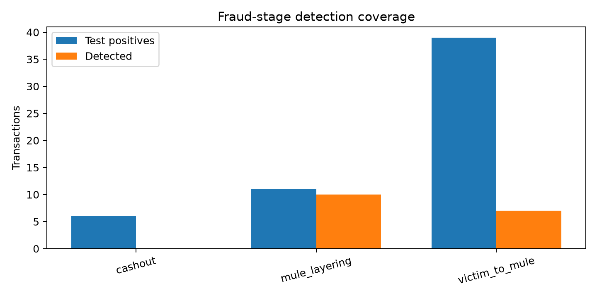
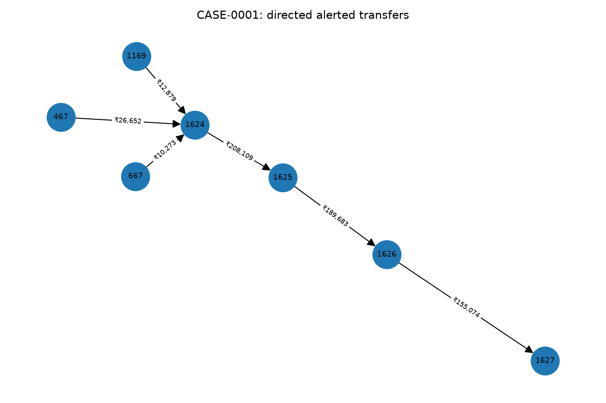
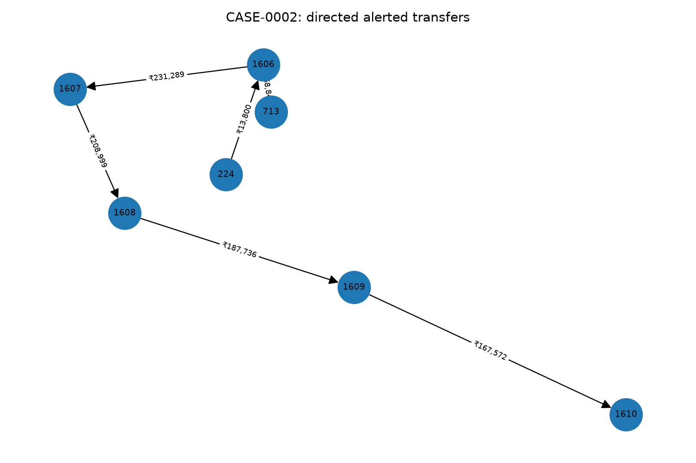

# APP Fraud Investigation Workbench

**An explainable transaction-monitoring and investigation system for identifying APP fraud patterns and tracing mule-account networks.**

## TL;DR

APP fraud involves victims being manipulated into transferring money to accounts controlled by fraudsters. Those funds can then move through multiple mule accounts before being cashed out, making the transaction trail harder to investigate.

This project simulates that activity and builds a system to identify suspicious victim-to-mule payments, detect rapid fund transfers between mule accounts, and connect related accounts into investigation cases.

**What we found on the untouched synthetic test set:**

- Analysed **21,668 transactions**, including 56 fraud-stage transactions.
- Detected **17 fraud-stage transactions** with **zero false positives** in this test sample.
- Achieved **100% precision**, **30.36% recall**, and an **F1 score of 0.4658**.
- Detected 10 of 11 mule-layering transactions.
- Detected 7 of 39 victim-to-mule transactions.
- Identified cashout sequences as a major gap in the current detection approach.

**The key finding:** Historical fund-flow behaviour helped identify mule-layering activity. However, detecting the initial victim payments and subsequent cashout activity requires stronger sequence-level investigation.

## Key Results

| Metric | Result |
|---|---:|
| Transactions evaluated | 21,668 |
| Fraud-stage transactions | 56 |
| True positives | 17 |
| False positives | 0 |
| False negatives | 39 |
| Precision | 100% |
| Recall | 30.36% |
| F1 score | 0.4658 |

---

## Key Results

Evaluated on an untouched synthetic test set:

| Metric | Result |
|---|---:|
| Transactions evaluated | 21,668 |
| Fraud-stage transactions | 56 |
| True positives | 17 |
| False positives | 0 |
| False negatives | 39 |
| Precision | 100% |
| Recall | 30.36% |
| F1 score | 0.4658 |

**Interpretation:** The detector was conservative on this synthetic holdout. It identified a subset of suspicious activity without false alerts in this sample, but missed 39 fraud-stage transactions. These results are not representative of production performance.

## What It Does

- **Transaction simulation:** Generates synthetic customers, mule accounts, transactions, and coordinated fraud campaigns.
- **Point-in-time features:** Calculates historical transaction activity and fund-flow behaviour without using future events.
- **Temporal evaluation:** Uses time-based train, validation, and test splits with delayed-label handling.
- **Explainable detection:** Applies transparent rules for suspicious receiving accounts and rapid fund forwarding.
- **Network investigation:** Groups connected alert accounts into investigation cases with supporting transaction evidence.
- **Miss analysis:** Examines undetected fraud patterns to identify weaknesses in the current detection approach.

## Detection Approach

| Investigation pattern | Signals |
|---|---|
| Victim-to-mule | New receiving account, transaction amount, historical incoming volume |
| Mule layering | Recent incoming funds and outgoing-to-incoming amount ratio |
| Cashout | Prior outgoing activity retained as contextual evidence |

The system uses rule-based prioritisation. Its scores are not calibrated fraud probabilities, and an alert is an investigative lead, not proof of fraud.

## Test Results by Fraud Stage



| Fraud stage | Detected | Missed |
|---|---:|---:|
| Victim-to-mule | 7 | 32 |
| Mule layering | 10 | 1 |
| Cashout | 0 | 6 |

Cashout detection remains an identified gap. Repeated outgoing activity generated too many legitimate alerts to be used as an independent detection rule.

## Investigation Evidence

The network investigation groups connected alert accounts into cases and preserves transaction-level evidence for review.

**Example investigation networks:**





Additional cases and evaluation charts are available in [`results/evidence/`](results/evidence/).

## Technical Overview

- **Language:** Python
- **Data processing:** Pandas, NumPy, DuckDB, PyArrow
- **Detection:** Explainable rule-based engine
- **Network analysis:** NetworkX
- **Visualisation:** Matplotlib
- **Testing:** Pytest

### Pipeline

1. Generate synthetic transaction and account data.
2. Engineer historical transaction and fund-flow features.
3. Construct delayed-label temporal datasets.
4. Evaluate detection rules and generate alerts.
5. Group connected accounts into investigation cases.
6. Evaluate performance and analyse missed fraud.
7. Generate reports, charts, and investigation evidence.

## Repository Outputs

| Location | Contents |
|---|---|
| `data/` | Synthetic accounts, transactions, features, labels, and temporal splits |
| `results/reports/` | Executive summary, methodology, evaluation, casebook, and technical report |
| `results/evidence/charts/` | Test metrics, confusion matrix, stage detection, and campaign results |
| `results/evidence/networks/` | Investigation network visualisations |
| `sql/` | Feature engineering queries |

Start with the [Executive Summary](results/reports/executive_summary.md), then review the [Technical Report](results/reports/technical_report.md).

## Limitations

- All data is synthetic. No real customer or banking records are used.
- Fraud examples are limited and generated from predefined campaign behaviours.
- The simulator contains known shortcuts and does not represent the full complexity of real financial fraud.
- Zero false positives on this test set does not establish production precision.
- Cashout detection is incomplete.
- The system has not been validated against real-world banking data.

**This is a research and investigation prototype, not a production fraud detection system.**

## Reproducibility

Install dependencies in a Python virtual environment:

```powershell
python -m venv .venv
.\.venv\Scripts\Activate.ps1
pip install -r requirements.txt
```

The generated datasets and supporting reports are included in the repository. The individual pipeline scripts are available at the project root.

---

*Built as an applied investigation into transaction behaviour, mule-account networks, explainable detection, and evidence-driven fraud analysis.*
